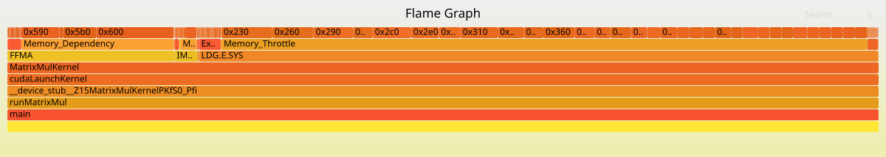
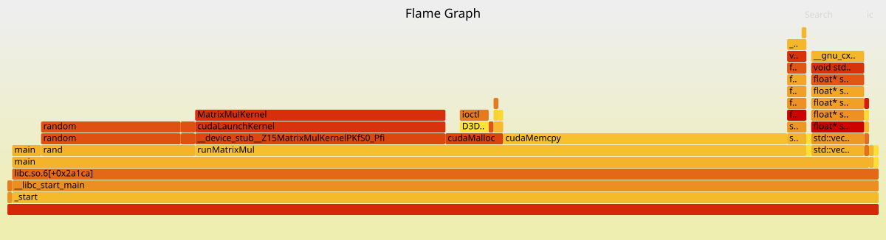

# cuda-flame-graph
Это профилировщик для CUDA-программ. Он собирает CPU-контекст запуска кернела,
GPU stall-сэмплы и делает folded-файл для FlameGraph.

## Требования
Для работы с профилировщиком требуется ОС Linux с видеокартой NVIDIA. Для сборки и запуска должны быть установлены:

- драйвер NVIDIA;
- CUDA Toolkit 12.x с `nvcc`, CUPTI, `cuobjdump` и `cu++filt`. CUDA Toolkit 13
  пока не поддерживается, потому что используемый legacy CUPTI PC Sampling API
  был из него удалён;
- GCC/G++ и Make;
- CMake версии 3.24 или новее;
- Python 3 для добавления названий SASS-инструкций;
- Perl для создания SVG с помощью `flamegraph.pl`;

Основной stall mode использует CUPTI PC Sampling, поэтому для его запуска нужна
поддерживающая этот режим NVIDIA GPU.

## Сборка
```bash
mkdir -p build
cd build
cmake ..
make
cd ..
```

Семплы собираются под архитектуру установленной видеокарты. Проверить, что у
бинарника действительно есть нужный cubin, можно так:

```bash
cuobjdump -lelf build/samples/matrixMul/matrixMul
```

SASS берётся из cubin внутри указанного бинарника. Поэтому архитектура бинарника
должна совпадать с архитектурой GPU. Если точного совпадения функции и PC нет,
скрипт ничего не угадывает и оставляет исходный PC.

## FlameGraph
Перед запуском `cuprof-sass` скачайте репозиторий FlameGraph Брендана Грегга.
Удобнее расположить его рядом с папкой профилировщика:

```bash
git clone https://github.com/brendangregg/FlameGraph.git ../FlameGraph
```

## Режимы работы
У профилировщика есть два режима:

- stall mode - основной режим для подробного анализа выполнения CUDA-кернелов.
  Он показывает SASS-инструкции, причины простоя и PC-оффсеты;
- non-stall mode - показывает запуски CUDA-кернелов в общем CPU-профиле
  приложения.

В stall mode в графе получается примерно такая цепочка:

```text
CPU стек -> cudaLaunchKernel -> kernel -> SASS инструкция -> причина простоя -> PC
```

## Обычный запуск
Самый простой способ - использовать `cuprof-sass`. Он сам запустит профайлер в stall режиме, добавит названия SASS-инструкций и сделает итоговый flame graph:

```bash
./cuprof-sass \
  --output results/stall/matrix_mul \
  --sampling-period-exp 10 \
  --arch sm_75 \
  --flamegraph ../FlameGraph/flamegraph.pl \
  -- build/samples/matrixMul/matrixMul
```

В итоге рядом появятся файлы:

```text
matrix_mul.folded
matrix_mul_sass.folded
matrix_mul.stderr
matrix_mul_sass.stderr
matrix_mul.svg
```

Получаем такой flame граф:



Общий вид команды:

```bash
./cuprof-sass [флаги] -- программа [аргументы программы]
```

После `--` указывается CUDA-программа. Там же можно передать любые её аргументы.

## Флаги запуска

У `cuprof-sass` и `cuprof` одинаково работают два флага периода:

- `--sampling-period` - один из готовых периодов: `min`, `low`, `mid`, `high`
  или `max`. По умолчанию используется `low`. Чем меньше период, тем чаще
  берутся сэмплы и тем выше overhead;
- `--sampling-period-exp` - точный период `2^N` GPU-циклов, где N от 5 до 31.
  Например, `14` означает 16384 цикла. Этот флаг используется вместо
  `--sampling-period`.

Остальные флаги `cuprof-sass` относятся к созданию итоговых файлов:

- `--output` - путь и общее имя результатов. Например `results/test`;
- `--arch` - архитектура CUDA-бинарника. Например `sm_75`;
- `--cuprof` - путь к `cuprof`. По умолчанию используется `build/cuprof`;
- `--flamegraph` - путь к `flamegraph.pl`. Если его не указать, SVG не будет
  создан, но folded-файлы сохранятся;
- `-h` или `--help` - показать справку.

`cuprof-sass` всегда запускает `cuprof` в stall mode. При ручном запуске у
`cuprof` дополнительно доступны:

- `--stall-mode` - включить сбор GPU stall-сэмплов. Без него запускается
  non-stall режим;
- `--show-all-stalls` - не отбрасывать `STALL_NONE` и показать все причины,
  которые вернул CUPTI;
- `-f` или `--freq` - частота CPU-сэмплирования в герцах для non-stall режима.
  Например `-f 99`;
- `-p` или `--profile` - профиль фильтрации CPU-фреймов: `minimal`, `standard`,
  `full` или `debug`;
- `-h` или `--help` - показать справку.

Профили фильтрации:

- `minimal` - код программы и основные функции CUDA API;
- `standard` - то же самое плюс системные библиотеки. Это обычный вариант;
- `full` - добавляются внутренности CUDA Driver/Runtime и неизвестные функции;
- `debug` - показывается всё, включая внутренности самого профилировщика.

Для CPU `perf_event` нужен `sudo`. Для stall mode `sudo` не нужен.

В проекте есть несколько готовых CUDA-примеров:

- `vectorAdd` - простое сложение векторов;
- `matrixMul` - умножение матриц;
- `relu` - простая функция активации;
- `gelu` - функция активации с более сложными вычислениями;
- `softmax` - обработка строк матрицы с reduction и синхронизацией потоков.
- `matrixCompare` - три последовательных варианта умножения матриц: простой,
  с накоплением в регистре и с использованием shared memory.

Все они после сборки находятся в `build/samples/<имя>/<имя>`.

В stderr-файлах лежит статистика профайлера и SASS-корреляции.

Если запустить команду ещё раз с тем же `--output`, старые SASS и SVG сначала
удалятся. Поэтому после ошибки рядом с новым raw-файлом не останется старый граф.

Если стандартный период не подходит, можно указать промежуточный:

```bash
./cuprof-sass \
  --output results/matrix_16384 \
  --arch sm_75 \
  --sampling-period-exp 14 \
  -- build/samples/matrixMul/matrixMul
```

CUPTI принимает показатель от 5 до 31. Сам период равен `2^N` циклов, поэтому
произвольное число циклов указать нельзя.

## Что делает cuprof-sass
Внутри всё по-прежнему разделено на несколько простых шагов:

```text
cuprof -> raw folded -> enrich_sass.py -> SASS folded -> flamegraph.pl
```

## Ручной запуск
Сначала снимаем raw stall-профиль:

```bash
mkdir -p results/stall
cd build
./cuprof --stall-mode --sampling-period low \
  ./samples/matrixMul/matrixMul \
  > ../results/stall/matrix_mul.folded \
  2> ../results/stall/matrix_mul.stderr
cd ..
```

Потом добавляем SASS-инструкции:

```bash
python3 scripts/enrich_sass.py \
  --input results/stall/matrix_mul.folded \
  --binary build/samples/matrixMul/matrixMul \
  --arch sm_75 \
  --output results/stall/matrix_mul_sass.folded \
  2> results/stall/matrix_mul_sass.stderr
```

И собираем итоговый flame graph:

```bash
../FlameGraph/flamegraph.pl \
  results/stall/matrix_mul_sass.folded \
  > results/stall/matrix_mul.svg
```

## Non-stall режим
Он показывает CUDA-кернелы в общем контексте CPU-профиля:

```bash
mkdir -p results/nonstall
sudo build/cuprof -f 99 build/samples/matrixMul/matrixMul \
  > results/nonstall/matrix_mul_f99.folded \
  2> results/nonstall/matrix_mul_f99.stderr
```

Для non-stall режима на этой машине нужен `sudo`, потому что CPU-сэмплы
собираются через Linux `perf_event`.

Из полученного folded-файла можно сделать flame graph:

```bash
../FlameGraph/flamegraph.pl \
  results/nonstall/matrix_mul_f99.folded \
  > images/nonstall_matmul_f99.svg
```

Получается такой граф:



